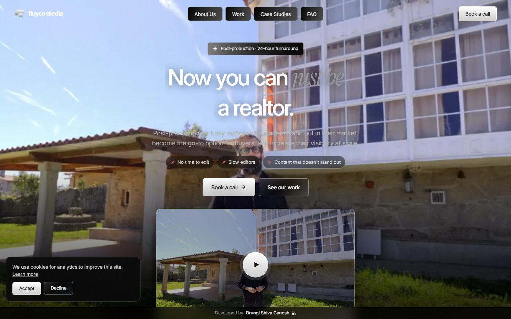
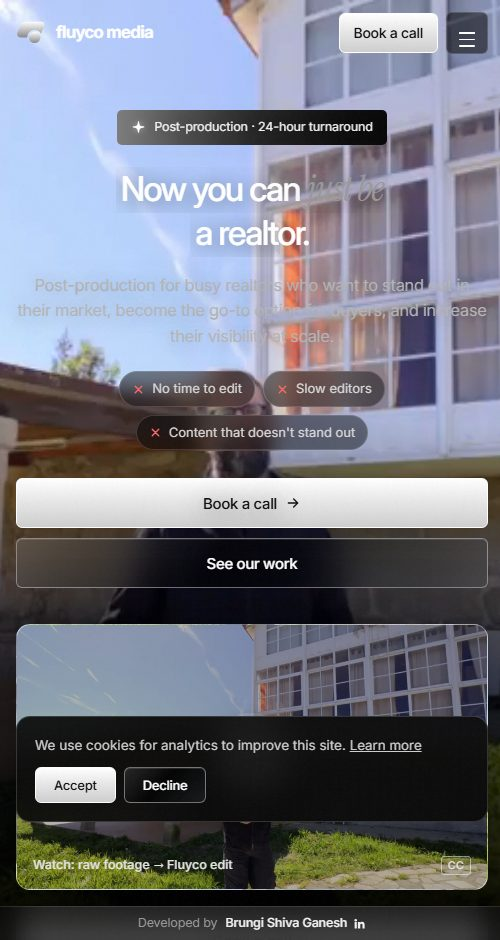
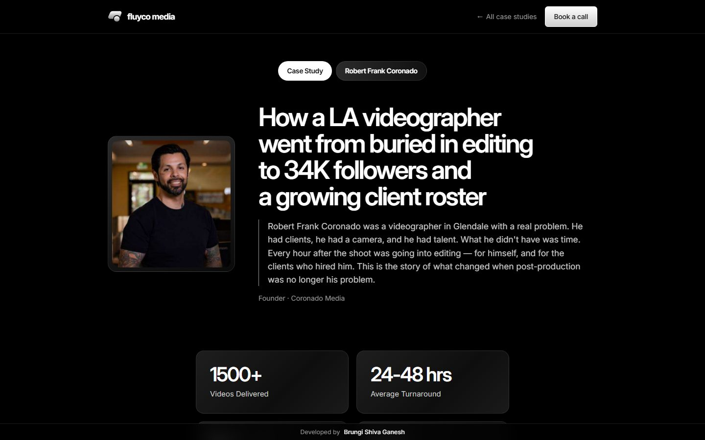
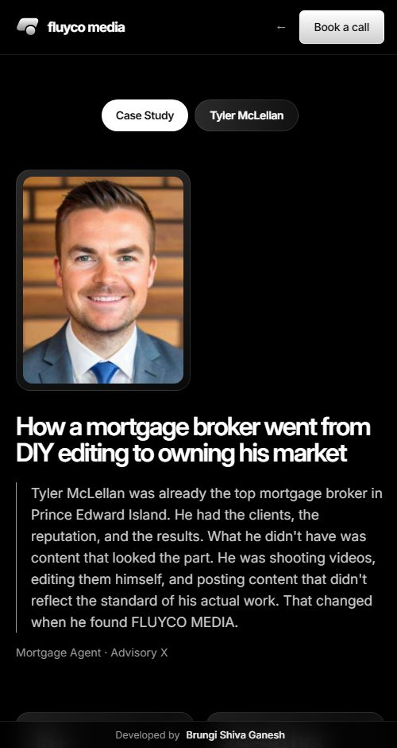

# Fluyco Media — Website

Video-first landing page for **Fluyco Media**, a done-for-you video post-production agency for realtors, mortgage agents, founders and media agencies. The page has one job: turn a visitor into a booked discovery call on [Cal.com](https://cal.com/fluycomedia/30min).

**Live:** https://fluycomedia.vercel.app

## Screenshots

| Desktop | Mobile |
|---|---|
|  |  |
|  |  |

## What's on the page

1. Sticky header that turns solid after scrolling, highlights the current section, and collapses to a menu on phones
2. Hero with a background video, pain-point chips, **Book a call** and a showreel player
3. Scrolling client strip
4. Problems & Solutions table (stacks into cards on phones)
5. Our Work: talking-head reels with hover previews and a full-screen player
6. Portfolio with category filter tabs
7. Clients, case studies with stat grids, and testimonials that link to full case-study pages
8. FAQ accordion
9. About Us with founder cards
10. Closing call to action, footer, and a fixed **Developed by** credit bar

**Booking:** every **Book a call** button opens Cal.com in a pop-up on the site, or in a new tab when the pop-up isn't available. Each click is tracked with where it came from.

**Analytics events:** `book_call_click`, `booking_completed`, `intro_video_play`, `portfolio_video_play`, `case_study_open` and scroll depth. These are pushed to `dataLayer` and only sent to GA4, Plausible or PostHog after the visitor accepts cookies.

**SEO and accessibility:** Open Graph tags, Schema.org markup (Organization, VideoObject, FAQPage, Review), keyboard-friendly menus and players, and `prefers-reduced-motion` support.

## Files

| File | What it is |
|---|---|
| `index.html` | Page markup, plus the `CONTENT` object (all text, videos and clients) and the script that renders the page |
| `styles.css` | All styles: color tokens, components, animations, breakpoints |
| `build_case_studies.py` | Generates `case-studies/*.html` from the case-study text (originally Wix PDFs) |
| `build_dist.py` | Copies everything into `dist/` for deployment |

To change any text, video or client, edit the `CONTENT` object near the top of the `<script>` in `index.html`.

## Not in this repo

These folders hold large media or generated files and are kept out of Git:

- `assets/`: videos (`assets/video/v01–v13.mp4`), posters and photos (`assets/img/`)
- `case-studies/`: generated by `python build_case_studies.py`
- `dist/`: the deploy folder

## Run locally

```bash
python build_case_studies.py      # builds case-studies/*.html
python -m http.server 8000         # then open http://localhost:8000
```

`assets/` must sit next to `index.html` for the videos and photos to load.

## Deploy (Vercel)

```bash
python build_dist.py
cd dist && npx vercel deploy --prod
```

---

Developed by [Brungi Shiva Ganesh](https://www.linkedin.com/in/brungi-shiva-ganesh)
